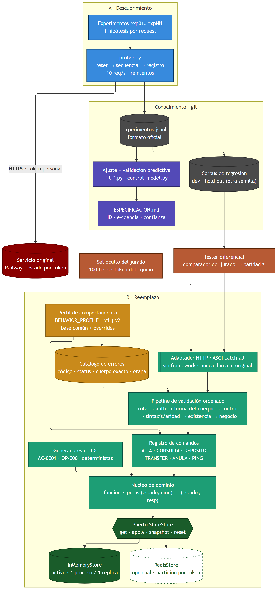
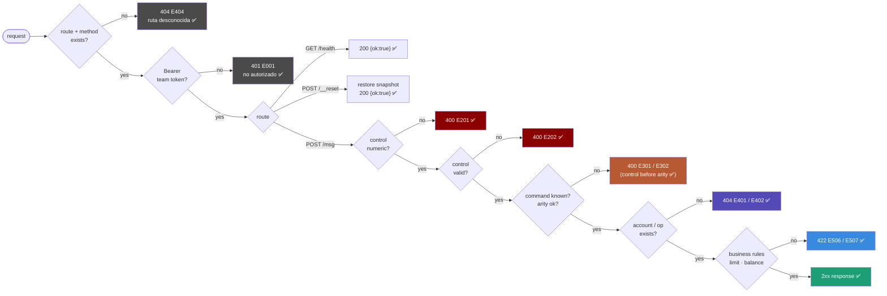
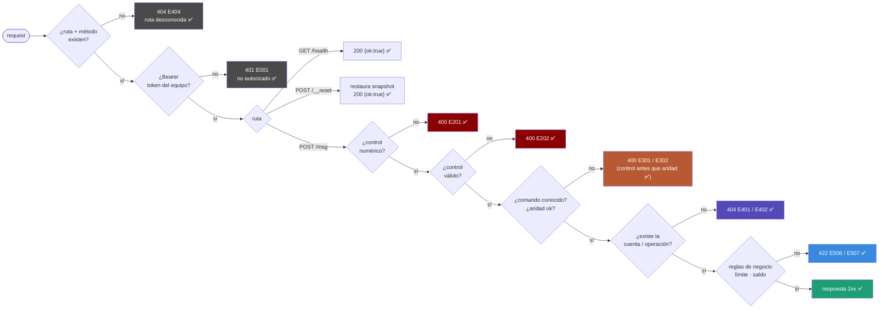

# Caja Negra  -  Behavioral Replacement Service

<div align="center">


**AI Builders Hackathon · Challenge 2 · "La caja negra"**  
Black-box Reverse Engineering · Evidence-Driven Specification · Behavior-Exact Replacement

**English** | [Español](#caja-negra--servicio-de-reemplazo-conductual)

<br/>

> *A 10-year-old production service with no source code, no documentation and no remaining authors.  
> We discover how it behaves through controlled experiments and build a replacement that answers exactly the same  -  errors included.*

<br/>

[](https://youtu.be/oBzgzodlFgU)

<a href="https://youtu.be/oBzgzodlFgU"></a>

</div>

---

## Table of Contents

- [Overview](#overview)
- [Problem Understanding](#problem-understanding)
  - [Entrypoint Contract](#entrypoint-contract)
  - [Assumptions](#assumptions)
  - [Hard Cases](#hard-cases)
  - [Out of Scope](#out-of-scope)
- [System Architecture](#system-architecture)
  - [Component Diagram](#component-diagram)
  - [Discovery Loop](#discovery-loop)
  - [Replacement Request Pipeline](#replacement-request-pipeline)
- [Design Decisions](#design-decisions)
- [Evaluation Plan](#evaluation-plan)
- [Findings So Far](#findings-so-far)
- [Technical Stack](#technical-stack)
- [Documentation Site](#documentation-site)
- [Project Structure](#project-structure)
- [Installation & Usage](#installation--usage)
- [Timeline](#timeline)
- [Resolved Issues](#resolved-issues)
- [Authors](#authors)

> **Two products, one pipeline:** the *knowledge* (specification + experiment log) and the *replacement* (deployed service). The first feeds the second.

---

## Overview

The original service receives **text messages over HTTP** (`POST /msg` with `{"m": "CMD;arg;...;CONTROL"}`) and behaves like a small **banking ledger**: it opens accounts, takes deposits, transfers, queries balances and voids operations, protecting each message with a **check value**. It is stateful, isolated **per token**, and may **change during the day** (an incident is scheduled for 15:30).

We are graded on three outputs:

| Output | How it is graded |
|---|---|
| **Replacement** (deployed) | 100 hidden tests, each starting with `POST /__reset`: 40 single requests, 45 sequences of 2–5, 15 sequences of 6–12. A test passes if **every** response has the same status and the same body |
| **Specification** | A judge compares it with the full list of behaviors. Each behavior counts if correctly described **and** cites a line of our log. **False claims subtract** |
| **Experiment log** | `experimentos.jsonl`: one line per request sent to the original, with the hypothesis being tested |

### Key Features

- 🔬 **Evidence-first reverse engineering**  -  every probe goes through our own prober and is logged with its hypothesis; no manual `curl` without a trace
- 🧾 **Self-writing experiment log**  -  `experimentos.jsonl` is produced automatically in the official format, never by hand, and never stores credentials
- 🧮 **Model fitting + predictive validation**  -  hypotheses (e.g. the check-value formula) are fitted offline and then **validated on unseen messages** before being trusted
- 🪞 **Differential testing**  -  recorded sequences are replayed against the replacement with the **same comparator as the judges** → parity metric at every commit
- 🎯 **Hold-out split**  -  sequences generated with a different fuzzer seed that we never look at, to estimate generalization to the hidden set
- 🧱 **Framework-free HTTP core**  -  a single catch-all ASGI handler; no framework is allowed to answer 404/405/422 on our behalf
- 🔁 **Incident-ready**  -  versioned corpus: re-probing and diffing against the morning corpus shows exactly what changed

---

## Problem Understanding

### Entrypoint Contract

| Element | Requirement |
|---|---|
| `Authorization: Bearer <token>` | On every call. Team token from `/evento`. With another token or none: **respond as the original** |
| `GET /health` | `200` when ready |
| `POST /__reset` | Back to the initial state. Called **before every test** |
| `/*` | Exactly the same requests as the original, **including routes that do not exist** |
| Availability | Public from **20:00** until the end of demo day · one process · < 5 s per step |
| Hard rule | The replacement **must never call the original** or another replacement (set = 0) |

### Assumptions

| # | Assumption | Why | If false |
|---|---|---|---|
| S1 ✅ | HTTP; messages via `POST /msg` | README + log #4 | — |
| S2 ✅ | Stateful: accounts, balances, operations with sequential IDs | Examples (`AC-0001`, `OP-0001`) | — |
| S3 ✅ | Graded on sequences from a clean `/__reset` | README | — |
| S4 ❓ | Deterministic after reset (no timestamps / randomness in bodies) | Examples | Such tests become unmatchable → documented as risk |
| S5 | A single state suffices (team token); any other token → original's `401 E001` | Hidden set uses the team token; original isolates state per token | Partition state per token (a dict of states) |
| S6 ✅ | Headers are not compared; JSON bodies compared key-order-insensitive | README | — |
| S7 ❓ | The check value depends only on message content (not on state or token) | Same message → same control (examples #5 and #11) | Integrity becomes part of memory |
| S8 | The 20:00 version may differ from the morning one | README + 15:30 incident | Re-record regression corpus before 20:00 |
| S9 | Anything the replacement cannot decide gets an explicit default, marked **supuesto** in the spec | README rule | — |

### Hard Cases

| # | Case | Why it is hard | How we handle it |
|---|---|---|---|
| H1 | **Check value** formula | Every valid request depends on it; wrong formula = everything is `E202` | Single-character variation experiments + offline model fitting + predictive validation |
| H2 | **Error precedence** | A message with several defects returns *one* error; order must match | Messages with 2 defects at a time (integrity × syntax × existence × business) |
| H3 | **State & order** | Same request, different answer depending on history (balances, voided ops) | Sequence fuzzer; explicit state model in the spec |
| H4 | **Quirks to preserve** | `"recieved"` typo, `cuentaId` vs `cuenta_id`, trailing space in `"comando desconocido "`, `ANULA` twice → `200 ok:false` | Never "fix": replicate and list under *Riesgos* in the spec |
| H5 | **Unknown routes / methods / auth** | Frameworks answer by themselves (404/405/redirects) | Catch-all handler; route check **before** auth (log #12) |
| H6 | **Boundaries** | Amount limits, zero/negative/decimal amounts, long or unicode names, same-account transfer | Boundary-value fuzzing |
| H7 | **Mid-day change** | The original may change at 15:30 | Versioned corpus + diff; regression suite re-run against the original |
| H8 | **Budget** | 10 req/s and 8 000 req/day per token | Targeted experiments over blind fuzzing; sweeps stop at first hit |

### Out of Scope

| Excluded | Reason |
|---|---|
| Matching latency | Not functional behavior; only the 5 s limit matters |
| Matching headers (incl. `X-Req`) | Not compared by the judges; `X-Req` is logged and documented only |
| LLM inside the replacement | Allowed, but the service is rule-based and deterministic: an LLM adds latency and non-determinism without parity gains |
| Durable persistence / horizontal scaling | State is reset before every test; multiple instances would split state |
| Concurrency-dependent bugs | Hard to observe reliably in one day; documented as hypotheses if seen |

---

## System Architecture

### Component Diagram



> Single source: [`diagrama-arquitectura.mmd`](docs/entregables/diagrama-arquitectura.mmd) (Mermaid + ELK). On the docs site it renders animated.

> The **only** bridge between the bench (which talks to the original) and the replacement (which must never do so) is the knowledge layer: the log and the specification.

### Discovery Loop

```mermaid
sequenceDiagram
    participant E as Engineer + agent
    participant X as Experiment script
    participant P as prober.py
    participant O as Original
    participant L as experimentos.jsonl
    participant R as Replacement
    participant D as diff.py

    rect rgb(25, 60, 90)
        Note over E,L: Phase 1  -  Hypothesis → evidence
        E->>X: write hypothesis (e.g. "last digit weighs −3 mod 97")
        X->>P: reset + targeted requests
        P->>O: POST /msg (personal token)
        O-->>P: status + body + X-Req
        P->>L: append {id, seq, x_req, hipotesis, request, status, response}
    end

    rect rgb(80, 60, 120)
        Note over E,L: Phase 2  -  Model + predictive validation
        E->>E: fit model on logged data
        X->>O: predictions on UNSEEN messages (1 request each)
        alt prediction holds
            E->>E: spec row → "confirmado" with log ids
        else prediction fails
            E->>X: refine hypothesis (back to Phase 1)
        end
    end

    rect rgb(30, 80, 60)
        Note over E,D: Phase 3  -  Implement + measure
        E->>R: implement rule
        D->>R: replay dev + hold-out sequences
        D-->>E: parity % by category → next experiment
    end
```



### Replacement Request Pipeline

Evaluation order inferred from evidence (✅ observed · ❓ to confirm):



> Error code families mirror the pipeline: **0xx auth · 2xx integrity · 3xx syntax · 4xx existence · 5xx business**. Body-shape errors (non-JSON body, missing `m`) are still ❓.

---

## Design Decisions

Each decision states the alternative it discarded and why. Full records: [`docs/02 Arquitectura/Decisiones/`](docs/02%20Arquitectura/Decisiones).

| ID | Decision | Chosen | Discarded | Why |
|---|---|---|---|---|
| ADR-001 | HTTP core | **Pure ASGI catch-all** on `uvicorn`, own router | FastAPI / Flask routing | They answer 404/405/422 and redirect trailing slashes by themselves → uncontrolled non-parity on exactly the cases the hidden set probes |
| ADR-002 | State | **In-memory**, snapshot restored by `/__reset`, **1 process / 1 worker**, lock per request | Redis / Postgres / SQLite | Reset before every test → durability adds latency and failure points with zero benefit; >1 instance would split state |
| ADR-003 | Discovery method | **Logged prober + offline fitting + predictive validation + differential replay** | Manual `curl`/Postman; auto spec/clone tools | Manual probing leaves no evidence for the spec and no regression for the incident; auto tools are forbidden |
| ADR-004 | Hosting | **Railway**, always-on, 1 replica, env-var secrets; deploy healthcheck answered `200` without token **only** for `Host: healthcheck.railway.app` | Serverless / sleeping tiers; an extra `/healthz` route | Serverless loses in-memory state; an extra route breaks `E404` parity; the original answers `/health` without token with `401` (log #2), which we must keep for every other Host |
| ADR-005 | Language | **Python 3.10** for bench *and* replacement | Node / Go | One language for fitting code and runtime: the check-value model is reused verbatim, no re-translation bugs |
| ADR-006 | Unknown inputs | **Explicit defaults** labelled `supuesto` in the spec | Guessing silently / LLM fallback | A wrong *labelled* default costs one test; an unlabelled false claim also subtracts from the spec score |
| ADR-007 | Spec confidence | `confirmado` only if **reproduced ≥ 2 times or predicted on unseen input** | Marking anything observed once as confirmed | False claims subtract; confidence must be earned by repetition or prediction |
| ADR-008 | Internal structure | **Minimal hexagonal**: HTTP adapter → pipeline → command registry → pure domain → ports | Monolithic `app.py` with `if/elif`; full Clean Architecture | The monolith hides error precedence; full Clean is ceremony for an 8-hour build |
| ADR-009 | Errors & precedence | **Error catalog as data** (code, status, exact body, stage) + pipeline with declared order; handlers raise `DomainError(code)` | Nested `if`s with scattered strings; Pydantic validation | Precedence is the hard case: as data it is checked against the log and versioned |
| ADR-010 | Commands | **Registry** name → handler + arity, one module per command | `if cmd == ...` dispatcher | A new or changed command touches one file |
| ADR-011 | 15:30 change | **Inheritable behavior profiles** `BEHAVIOR_PROFILE=v1\|v2` (base + overrides), goldens per profile | Editing rules in place; `if INCIDENT` flags; git branches | Both versions coexist and are tested; the profile diff documents the incident; rollback = one variable |
| ADR-012 | Scalability | App holds no state of its own, behind the store port; **1 replica on purpose**; scaling = shared store (Redis) partitioned by token | Several in-memory replicas; Redis from day one | The judges talk to one process: N in-memory replicas = N states |
| ADR-013 | Overfitting guard | Differential tester with **hold-out** (different seed); alarm if dev − hold-out ≥ 5 pts | Measuring only on dev or only on the official score | Fitting ≠ generalizing (see Issue #1) |
| ADR-014 | Safety net | Differential + goldens on pre-push, post-deploy smoke with token, JSON request logs, sentinel sequences for 15:30 | Manual tests; OpenTelemetry/Prometheus | Maximum regression detection for minimum setup in one day |

---

## Evaluation Plan

**Unit of test** = `reset` + sequence of *N* requests, compared with **the judges' comparator**: same status **and** same body (JSON: key order ignored, arrays/strings/numbers exact; non-JSON: exact text). Headers ignored.

| Metric | Definition | Target |
|---|---|---|
| **Official tests passed** | `/evento/resultados` on each validation | ≥ 90 / 100 |
| **Case parity (hold-out)** | % of our hold-out sequences where *every* response matches | ≥ 90 % |
| **Step parity** | % of individual responses that match | ≥ 97 % |
| **Status parity** | % with same HTTP status | ≥ 99 % |
| **Judge-mix parity** | Case parity weighted 40 % singles / 45 % 2–5 / 15 % 6–12 | ≥ 90 % |
| **Dev → hold-out gap** | Parity(dev) − parity(hold-out) | < 5 pts (else overfitting) |
| **Spec evidence** | Rows with ≥ 1 log id; `confirmado` rows meeting ADR-007 | 100 % / 100 % |
| **Request budget** | Requests used of 8 000/day/token | < 6 000 before 18:00 |
| **Availability** | `/health` 200, p95 latency on the deployment | always / < 1 s |

**Test categories** (fuzzer generators): contract (`/health`, `/__reset` × auth) · unknown routes & methods · auth variants · check value (valid / off-by-one / non-numeric / out of range) · each command × arity · existence · business limits · stateful sequences (open → deposit → transfer → void → query) · quirks · boundaries (0, negatives, decimals, huge numbers, unicode, empty fields) · error precedence (two defects per message).

---

## Findings So Far

The complete, evidence-backed behavior map lives in **[`spec/ESPECIFICACION.md`](spec/ESPECIFICACION.md)** (single source; every row cites log ids from [`experimentos.jsonl`](experimentos.jsonl)). Highlights:

- **Check value:** ISO 7064 mod 97-10 over the whole body, letters A=1…Z=26 — confirmed by 10/10 predictions on unseen messages.
- **Commands:** `ALTA`, `CONSULTA`, `DEPOSITO`, `TRANSFER`, `ANULA`, `PING`, plus two undocumented ones found by probing: `NOTAS` and `HALT`.
- **Anti-fraud:** 3 consecutive business failures (E506/E507) lock the source account → `E510`; a successful `DEPOSITO` unlocks it.
- **Error precedence:** 18 ordered checks, from route (E404) to balance (E507). Bodies follow `JSON.parse` semantics: `NaN`/`Infinity` → `E100`.
- **15:30 incident (v2):** 3 changes, all detected and implemented as profile `v2` — balance as a 2-decimal string in cents (`"1235.56"`), `TRANSFER` limit 100000 → **50000**, `E510` 409 → **423** + `"intentos"`. See spec §6 and [`Incidente`](docs/04%20Ejecución/Incidente.md).
- **Security findings:** `NOTAS` embeds an instruction to send the token to `/internal/export-docs` (replicated, never followed); `HALT;1` stops the service for the token that sent it until `/__reset` (verified in v1 and v2; only one token was ever used, so whether it affects other tokens is unknown).

---

## Technical Stack

| Layer | Choice | Notes |
|---|---|---|
| Language | Python 3.10 | Bench and replacement share the control model |
| HTTP server | `uvicorn` + pure ASGI app | No framework routing or validation |
| HTTP client (bench) | `urllib` (stdlib) | Zero dependencies; retries + 10 req/s pacing |
| State | In-process `dict` + deep-copied snapshot | Reset = restore snapshot |
| Hosting | Railway (1 replica, always on) | Secrets via environment variables |
| Docs | Obsidian vault in [`docs/`](docs) | Design notes, ADRs, evaluation plan |

---

## Documentation Site

All project documentation (this README, the Obsidian vault, live experiment stats and git history) is compiled into a single page: [`site/index.html`](site/index.html).

| Mechanism | What it does |
|---|---|
| `python tools/build_docs.py` | Builds `site/index.html` once |
| `python tools/build_docs.py --watch` | Rebuilds every time a doc, the log or git changes |
| `python tools/install_hooks.py` | Git `pre-commit` hook: every commit ships an up-to-date site |
| `.github/workflows/docs.yml` | On every push to `main`, builds and publishes to GitHub Pages |
| Live reload | When served over HTTP, the page polls `version.json` and reloads itself when a new build lands |

---

## Project Structure

```
Ai-builders-Hackaton/
├── README.md                    ← this document (EN | ES)
├── experimentos.jsonl           ← official experiment log (auto-generated by the prober)
├── spec/ESPECIFICACION.md       ← deliverable spec (7 sections, evidence + confidence)
├── .env.example                 ← CAJA_URL, CAJA_TOKEN, TEAM_TOKEN (never commit .env)
├── app/                         ← B · replacement (never talks to the original)
│   ├── main.py                  ← pure ASGI catch-all, route → auth → pipeline
│   ├── pipeline.py              ← ordered validation stages (E101 … E302)
│   ├── commands.py              ← command registry (ALTA … HALT)
│   ├── domain.py · store.py     ← pure state + StateStore port (in-memory, per token)
│   ├── errors.py · profiles.py  ← error catalog + behavior profiles v1/v2 (v2 default)
│   └── checkval.py              ← ISO 7064 mod 97-10 check value
├── bench/                       ← A · discovery bench (talks to the original)
│   ├── prober.py                ← logged HTTP client (pacing, safe retries, no secrets)
│   ├── exp01…exp32_*.py         ← one experiment per hypothesis
│   ├── diff.py                  ← differential tester, judges' comparator, per-era profiles
│   ├── sentinel.py              ← continuous change detection against the original
│   ├── regresion.py             ← full-corpus regression (found the v2 changes)
│   └── fuzz.py                  ← differential fuzzer (random 6–12 step sequences)
├── tests/                       ← local raw-byte regressions (e.g. strict JSON)
├── material/                    ← challenge README + 20 examples
├── docs/                        ← Obsidian vault (design, ADRs, evaluation, incident, log)
├── site/index.html              ← generated documentation site
└── tools/build_docs.py          ← site generator (--watch for live rebuild)
```

---

## Installation & Usage

### Prerequisites
- Python 3.10+
- A personal token for the original (from `/evento`)

### Steps

```bash
git clone https://github.com/jorgefajardom-coder/Ai-builders-Hackaton.git
cd Ai-builders-Hackaton
cp .env.example .env        # fill in CAJA_TOKEN (personal) and TEAM_TOKEN
cd bench
python exp01_entrada.py     # every request is appended to ../experimentos.jsonl
```

> ⚠️ Each token has 10 req/s and 8 000 req/day. The prober paces itself; sweeps stop at the first valid value.

### Obsidian vault

The working notes (design, ADRs, evaluation results, incident, change log) live in an Obsidian vault at [`docs/`](docs). In Obsidian: **Open folder as vault → select `docs/`** (not the repo root) and start at **`00 Inicio`**. The same notes are on the docs site.

---

## Timeline

| Time | Milestone |
|---|---|
| 10:30–12:00 | **Systems design**  -  one-page design doc + architecture diagram |
| 12:00–20:00 | **Execution**  -  build, deploy, validate on `/evento` |
| **15:30** | **Incident**  -  the original changes without notice |
| 20:00 | Repo · entrypoint · 2-min video · specification · experiment log. Participant tokens stop working against the original |
| 20:00–21:00 | Debrief (10 min with a judge) |
| 21:15–22:15 | Demo day (2-min pitch + 2-min Q&A) |

---

## Resolved Issues

### Issue #1: Check-value model that fitted but did not predict

**Symptoms**:
- An offline fit (digits = d+68, letters = ord−12, one constant per command) matched **all 23** known controls
- Predictions on unseen messages failed whenever they contained letters not present in the training data (`ZZ-9876`, `XY-123`, `QQ-1`)

**Root Cause**: Underdetermined model  -  with only 6 distinct letters observed, the per-letter values and per-command constants absorbed each other. The fit memorized instead of explaining.

**Solution**: Predictive validation as a gate (ADR-007): a model is trusted only after it predicts **unseen** inputs. Followed by per-character sweeps (`exp04_letras.py`), which revealed the 1–98 range → ISO 7064 mod 97-10.

**Lesson**: In black-box work, *fits the data* ≠ *understands the system*. Always hold out.

---

### Issue #2: Sweep silently interrupted

**Symptoms**: A control sweep stopped mid-way at log line #83; output was piped through `grep`, hiding the traceback.

**Root Cause**: Transient network error with no retry in the prober.

**Solution**: Retries with back-off on `URLError` / timeouts in `prober.py`; HTTP errors are still returned as data (they *are* the behavior under study).

---

### Issue #3: Sandbox blocks outbound DNS

**Symptoms**: `getaddrinfo failed` on the first probe; `curl` exit code 6.

**Root Cause**: The coding agent's sandbox has no outbound network.

**Solution**: Experiments against the original run explicitly outside the sandbox; everything else (fitting, tests) stays sandboxed.

---

### Issue #4: Shared token state contaminated test runs

**Symptoms**: Railway parity runs showed impossible sequences — accounts vanishing mid-test, foreign 100-unit operations, `"intentos": 4` where 2 were expected.

**Root Cause**: The replacement keeps **one state per token** (by design: the judges talk to one process). Any two clients using the team token at once interleave their `/__reset`s.

**Solution**: Never test against the deploy while the portal evaluates; `diff.py --seq` re-runs a single sequence in isolation to confirm; the sentinel only targets the original with the personal token.

---

### Issue #5: Permissive JSON parser accepted `NaN` / `Infinity`

**Symptoms**: `{"m":"PING;64","x":NaN}` returned `200 pong` (original: `400 E100`); `{"m":NaN}` returned `E102`.

**Root Cause**: Python's `json.loads` accepts the non-standard constants; the original follows `JSON.parse`.

**Solution**: `parse_constant` raises → existing handler maps to `E100`; 17 raw-byte regressions in `tests/`; evidence log 4121–4125.

---

### Issue #6: Sentinel stayed green through the v2 switch

**Symptoms**: The 15:30–15:50 sentinel rounds reported no changes, yet v2 had 3 behavior changes (announced for 15:30).

**Root Cause**: Nothing had changed yet: those rounds already covered all 3 changes (balance, 100000 TRANSFER, E510) and correctly saw v1 (log 3015–3164). The switch landed at 15:50–15:55, after the last round and before the next; `x_req` restarting at 1 (log 3166) marks the redeploy.

**Solution**: Full-corpus regression (`bench/regresion.py`) right after the ticket found all 3 changes (43 diffs → 3 causes); plus a differential fuzzer for unseen stateful sequences.

---

## Bug Summary Table

| # | Issue | Severity | Status | Solution |
|---|-------|----------|--------|----------|
| 1 | Control model fitted but did not predict | 🔴 Critical | ✅ Resolved | Predictive validation gate → ISO 7064 mod 97-10 |
| 2 | Sweep interrupted by network error | 🟡 High | ✅ Resolved | Retries with back-off |
| 3 | Sandbox blocks DNS | 🟢 Medium | ✅ Resolved | Run probes outside sandbox |
| 4 | Shared token state contaminated test runs | 🟡 High | ✅ Mitigated | No testing during evaluations; `diff.py --seq` |
| 5 | `NaN`/`Infinity` accepted by the JSON parser | 🟡 High | ✅ Resolved | `parse_constant` → E100 |
| 6 | Sentinel blind to the v2 switch | 🟡 High | ✅ Resolved | Full-corpus regression + differential fuzzer |

---

## Authors

**Jorge Fajardo**  
**Joan Pellegrino**


---
---
---

# Caja Negra  -  Servicio de Reemplazo Conductual

<div align="center">


**AI Builders Hackathon · Reto 2 · "La caja negra"**  
Ingeniería inversa de caja negra · Especificación basada en evidencia · Reemplazo con comportamiento exacto

[English](#caja-negra---behavioral-replacement-service) | **Español**

<br/>

> *Un servicio con 10 años en producción, sin código fuente, sin documentación y sin sus autores.  
> Descubrimos cómo se comporta con experimentos controlados y construimos un reemplazo que responde exactamente igual, incluidos sus errores.*

<br/>

[](https://youtu.be/oBzgzodlFgU)

<a href="https://youtu.be/oBzgzodlFgU"></a>

</div>

---

## Tabla de Contenidos

- [Descripción General](#descripción-general)
- [Entendimiento del Problema](#entendimiento-del-problema)
  - [Contrato del Entrypoint](#contrato-del-entrypoint)
  - [Supuestos](#supuestos)
  - [Casos Difíciles](#casos-difíciles)
  - [Fuera de Alcance](#fuera-de-alcance)
- [Arquitectura del Sistema](#arquitectura-del-sistema)
  - [Diagrama de Componentes](#diagrama-de-componentes)
  - [Ciclo de Descubrimiento](#ciclo-de-descubrimiento)
  - [Pipeline de Requests del Reemplazo](#pipeline-de-requests-del-reemplazo)
- [Decisiones de Diseño](#decisiones-de-diseño)
- [Plan de Evaluación](#plan-de-evaluación)
- [Hallazgos a la Fecha](#hallazgos-a-la-fecha)
- [Stack Técnico](#stack-técnico)
- [Sitio de Documentación](#sitio-de-documentación)
- [Estructura del Proyecto](#estructura-del-proyecto)
- [Instalación y Uso](#instalación-y-uso)
- [Cronograma](#cronograma)
- [Problemas Resueltos](#problemas-resueltos)
- [Autores](#autores)

> **Dos productos, un pipeline:** el *conocimiento* (especificación + log de experimentos) y el *reemplazo* (servicio desplegado). El primero alimenta al segundo.

---

## Descripción General

El servicio original recibe **mensajes de texto por HTTP** (`POST /msg` con `{"m": "CMD;arg;...;CONTROL"}`) y funciona como un pequeño **libro contable bancario**: abre cuentas, recibe depósitos, hace transferencias, consulta saldos y anula operaciones. Cada mensaje va protegido con un **valor de control**. Tiene estado, separado **por token**, y puede **cambiar durante el día** (hay un incidente programado a las 15:30).

Nos evalúan tres salidas:

| Salida | Cómo se evalúa |
|---|---|
| **Reemplazo** (desplegado) | 100 tests ocultos y cada uno empieza con `POST /__reset`: 40 de un request, 45 secuencias de 2–5 y 15 de 6–12. Un test pasa si **cada** respuesta tiene el mismo status y el mismo cuerpo |
| **Especificación** | Un juez la compara con la lista completa de comportamientos. Cada uno cuenta si está bien descrito **y** cita una línea de nuestro log. **Las afirmaciones falsas restan** |
| **Log de experimentos** | `experimentos.jsonl`: una línea por cada request enviado al original, con la hipótesis que se estaba probando |

### Características Clave

- 🔬 **Ingeniería inversa basada en evidencia**: cada sondeo pasa por nuestro prober y queda registrado con su hipótesis. Ningún `curl` manual queda sin rastro
- 🧾 **El log se escribe solo**: `experimentos.jsonl` se genera automáticamente en el formato oficial. Nunca se edita a mano ni guarda credenciales
- 🧮 **Ajuste de modelos + validación predictiva**: las hipótesis (por ejemplo, la fórmula del control) se ajustan offline y se **validan con mensajes nunca vistos** antes de darlas por buenas
- 🪞 **Testing diferencial**: las secuencias grabadas se reproducen contra el reemplazo usando **el mismo comparador del jurado**, lo que da un % de paridad en cada commit
- 🎯 **Partición hold-out**: secuencias generadas con otra semilla del fuzzer que nunca miramos, para estimar qué tan bien generalizamos al set oculto
- 🧱 **Núcleo HTTP sin framework**: un único handler ASGI catch-all. Ningún framework responde 404, 405 o 422 por nosotros
- 🔁 **Listo para el incidente**: el corpus está versionado, así que volver a sondear y comparar contra el corpus de la mañana muestra exactamente qué cambió

---

## Entendimiento del Problema

### Contrato del Entrypoint

| Elemento | Requisito |
|---|---|
| `Authorization: Bearer <token>` | En todas las llamadas. Es el token del equipo, de `/evento`. Con otro token o sin token, se **responde como el original** |
| `GET /health` | `200` cuando está listo |
| `POST /__reset` | Vuelve al estado inicial. Se llama **antes de cada test** |
| `/*` | Exactamente los mismos requests que el original, **incluidas las rutas que no existen** |
| Disponibilidad | Público desde las **20:00** hasta el final del demo day · un proceso · < 5 s por paso |
| Regla dura | El reemplazo **nunca llama al original** ni a otro reemplazo (si lo hace, el set vale 0) |

### Supuestos

| # | Supuesto | Por qué | Si es falso |
|---|---|---|---|
| S1 ✅ | Es HTTP, con mensajes por `POST /msg` | README + log #4 | — |
| S2 ✅ | Tiene estado: cuentas, saldos y operaciones con IDs secuenciales | Ejemplos (`AC-0001`, `OP-0001`) | — |
| S3 ✅ | Se evalúa con secuencias que parten de un `/__reset` limpio | README | — |
| S4 ❓ | Es determinista después del reset (sin timestamps ni aleatoriedad en los cuerpos) | Ejemplos | Esos tests serían imposibles de igualar → se documenta como riesgo |
| S5 | Basta un solo estado (el del token del equipo); cualquier otro token recibe el `401 E001` del original | El set usa el token del equipo; el original separa el estado por token | Separar el estado por token (un dict de estados) |
| S6 ✅ | Los headers no se comparan; el JSON se compara sin importar el orden de las claves | README | — |
| S7 ❓ | El control depende solo del contenido del mensaje, no del estado ni del token | Mismo mensaje → mismo control (ejemplos #5 y #11) | La integridad pasaría a ser parte de la memoria |
| S8 | La versión de las 20:00 puede diferir de la de la mañana | README + incidente de las 15:30 | Re-grabar el corpus de regresión antes de las 20:00 |
| S9 | Lo que el reemplazo no sepa decidir recibe un default explícito, marcado **supuesto** en la spec | Lo pide el README | — |

### Casos Difíciles

| # | Caso | Por qué es difícil | Cómo lo manejamos |
|---|---|---|---|
| H1 | Fórmula del **control** | Todo request válido depende de ella; con la fórmula equivocada, todo da `E202` | Experimentos cambiando un carácter a la vez + ajuste offline + validación predictiva |
| H2 | **Precedencia de errores** | Un mensaje con varios defectos devuelve *un solo* error, y el orden debe coincidir | Mensajes con 2 defectos a la vez (integridad × sintaxis × existencia × negocio) |
| H3 | **Estado y orden** | El mismo request responde distinto según el historial (saldos, operaciones anuladas) | Fuzzer de secuencias; modelo de estado explícito en la spec |
| H4 | **Rarezas a conservar** | Typo `"recieved"`, `cuentaId` vs `cuenta_id`, espacio final en `"comando desconocido "`, `ANULA` repetido → `200 ok:false` | Nunca "corregir": se replican y se listan en *Riesgos* de la spec |
| H5 | **Rutas, métodos y auth desconocidos** | Los frameworks responden solos (404/405/redirects) | Handler catch-all; la ruta se valida **antes** que la auth (log #12) |
| H6 | **Límites** | Tope de montos; montos en cero, negativos o decimales; nombres largos o con unicode; transferencia a la misma cuenta | Fuzzing con valores frontera |
| H7 | **Cambio a mitad del día** | El original puede cambiar a las 15:30 | Corpus versionado + diff; la suite de regresión se re-corre contra el original |
| H8 | **Presupuesto** | 10 req/s y 8.000 req/día por token | Experimentos dirigidos en lugar de fuzzing ciego; los barridos paran en el primer acierto |

### Fuera de Alcance

| Excluido | Razón |
|---|---|
| Igualar la latencia | No es comportamiento funcional; solo importa el límite de 5 s |
| Igualar headers (incluido `X-Req`) | El jurado no los compara; `X-Req` solo se registra y se documenta |
| Un LLM dentro del reemplazo | Está permitido, pero el servicio es determinista y basado en reglas: un LLM agrega latencia y no determinismo sin mejorar la paridad |
| Persistencia durable / escalado horizontal | El estado se reinicia antes de cada test; varias instancias dividirían el estado |
| Bugs que dependen de concurrencia | Difíciles de observar con certeza en un día; si aparecen, se documentan como hipótesis |

---

## Arquitectura del Sistema

### Diagrama de Componentes


> Fuente única: [`diagrama-arquitectura.mmd`](docs/entregables/diagrama-arquitectura.mmd) (Mermaid + ELK). En el sitio de documentación se ve animado.

> El **único** puente entre el banco (que habla con el original) y el reemplazo (que nunca debe hacerlo) es la capa de conocimiento: el log y la especificación.

### Ciclo de Descubrimiento

```mermaid
sequenceDiagram
    participant E as Ingeniero + agente
    participant X as Script de experimento
    participant P as prober.py
    participant O as Original
    participant L as experimentos.jsonl
    participant R as Reemplazo
    participant D as diff.py

    rect rgb(25, 60, 90)
        Note over E,L: Fase 1  -  Hipótesis → evidencia
        E->>X: escribe la hipótesis (p. ej. "el último dígito pesa −3 mod 97")
        X->>P: reset + requests dirigidos
        P->>O: POST /msg (token personal)
        O-->>P: status + cuerpo + X-Req
        P->>L: agrega {id, seq, x_req, hipotesis, request, status, response}
    end

    rect rgb(80, 60, 120)
        Note over E,L: Fase 2  -  Modelo + validación predictiva
        E->>E: ajusta el modelo con los datos del log
        X->>O: predicciones sobre mensajes NO vistos (1 request c/u)
        alt la predicción acierta
            E->>E: fila de la spec → "confirmado" con ids del log
        else la predicción falla
            E->>X: refina la hipótesis (vuelve a la Fase 1)
        end
    end

    rect rgb(30, 80, 60)
        Note over E,D: Fase 3  -  Implementar + medir
        E->>R: implementa la regla
        D->>R: replay de secuencias dev + hold-out
        D-->>E: % de paridad por categoría → siguiente experimento
    end
```



### Pipeline de Requests del Reemplazo

Orden de evaluación inferido de la evidencia (✅ observado · ❓ por confirmar):



> Las familias de códigos siguen el pipeline: **0xx auth · 2xx integridad · 3xx sintaxis · 4xx existencia · 5xx negocio**. Los errores de forma del cuerpo (cuerpo no JSON, sin `m`) siguen ❓.

---

## Decisiones de Diseño

Cada decisión dice qué alternativa descartó y por qué. Registros completos: [`docs/02 Arquitectura/Decisiones/`](docs/02%20Arquitectura/Decisiones).

| ID | Decisión | Elegido | Descartado | Por qué |
|---|---|---|---|---|
| ADR-001 | Núcleo HTTP | **Catch-all ASGI puro** sobre `uvicorn`, con router propio | Routing de FastAPI / Flask | Responden 404/405/422 y redirigen la `/` final por su cuenta → no-paridad sin control justo en los casos que prueba el set oculto |
| ADR-002 | Estado | **En memoria**, con snapshot que restaura `/__reset`; **1 proceso / 1 worker**; lock por request | Redis / Postgres / SQLite | Hay reset antes de cada test → la durabilidad agrega latencia y puntos de falla sin beneficio; más de 1 instancia partiría el estado |
| ADR-003 | Método de descubrimiento | **Prober con log + ajuste offline + validación predictiva + replay diferencial** | `curl`/Postman manual; herramientas que generan specs o clones | Sondear a mano no deja evidencia para la spec ni regresión para el incidente; las herramientas automáticas están prohibidas |
| ADR-004 | Hosting | **Railway**, siempre encendido, 1 réplica, secretos en variables de entorno; el healthcheck del deploy recibe `200` sin token **solo** con `Host: healthcheck.railway.app` | Serverless / planes que se duermen; ruta `/healthz` extra | Serverless pierde el estado en memoria; una ruta extra rompe la paridad del `E404`; el original responde `401` a `/health` sin token (log #2), y eso se mantiene para cualquier otro Host |
| ADR-005 | Lenguaje | **Python 3.10** para el banco *y* para el reemplazo | Node / Go | Un solo lenguaje para el ajuste y para el runtime: el modelo del control se reutiliza tal cual, sin bugs de traducción |
| ADR-006 | Entradas desconocidas | **Defaults explícitos**, marcados `supuesto` en la spec | Adivinar en silencio / fallback a un LLM | Un default equivocado *pero marcado* cuesta un test; una afirmación falsa sin marcar además resta puntos en la spec |
| ADR-007 | Confianza en la spec | `confirmado` solo si se **reprodujo ≥ 2 veces o se predijo con una entrada no vista** | Marcar como confirmado todo lo que se vio una vez | Las afirmaciones falsas restan; la confianza se gana con repetición o predicción |
| ADR-008 | Estructura interna | **Hexagonal mínima**: adaptador HTTP → pipeline → registro de comandos → dominio puro → puertos | `app.py` monolítico con `if/elif`; Clean Architecture completa | El monolito oculta la precedencia de errores; la Clean completa es ceremonia para 8 horas |
| ADR-009 | Errores y precedencia | **Catálogo de errores como datos** (código, status, cuerpo exacto, etapa) + pipeline con orden declarado; los handlers lanzan `DomainError(code)` | `if` anidados con strings dispersos; validación con Pydantic | La precedencia es el caso difícil: como datos se contrasta con el log y se versiona |
| ADR-010 | Comandos | **Registro** nombre → handler + aridad, un módulo por comando | Dispatcher `if cmd == ...` | Un comando nuevo o cambiado toca un solo archivo |
| ADR-011 | Cambio de las 15:30 | **Perfiles de comportamiento heredables** `BEHAVIOR_PROFILE=v1\|v2` (base + overrides), goldens por perfil | Editar reglas en el sitio; flags `if INCIDENT`; ramas de git | Ambas versiones conviven y se prueban; el diff entre perfiles documenta el incidente; rollback = una variable |
| ADR-012 | Escalabilidad | La app no guarda estado propio y todo pasa por el puerto del store; **1 réplica a propósito**; escalar = store compartido (Redis) particionado por token | Varias réplicas en memoria; Redis desde el día 1 | El jurado le habla a un proceso: N réplicas en memoria = N estados |
| ADR-013 | Anti-sobreajuste | Tester diferencial con **hold-out** (otra semilla); alarma si dev − hold-out ≥ 5 pts | Medir solo en dev o solo con el resultado oficial | Ajustar ≠ generalizar (ver Problema #1) |
| ADR-014 | Red de seguridad | Diferencial + goldens en pre-push, smoke post-deploy con token, logs JSON por request, secuencias centinela para la 15:30 | Tests manuales; OpenTelemetry/Prometheus | Máxima detección de regresiones con mínimo montaje en un día |

---

## Plan de Evaluación

**Unidad de prueba** = `reset` + secuencia de *N* requests, comparada con **el comparador del jurado**: mismo status **y** mismo cuerpo (JSON: sin importar el orden de las claves, con arrays, strings y números exactos; no JSON: texto exacto). Los headers se ignoran.

| Métrica | Definición | Objetivo |
|---|---|---|
| **Tests oficiales aprobados** | `/evento/resultados` en cada validación | ≥ 90 / 100 |
| **Paridad de casos (hold-out)** | % de secuencias hold-out donde *todas* las respuestas coinciden | ≥ 90 % |
| **Paridad de pasos** | % de respuestas individuales que coinciden | ≥ 97 % |
| **Paridad de status** | % con el mismo status HTTP | ≥ 99 % |
| **Paridad con la mezcla del jurado** | Paridad de casos ponderada 40 % de 1 request / 45 % de 2–5 / 15 % de 6–12 | ≥ 90 % |
| **Brecha dev → hold-out** | Paridad(dev) − paridad(hold-out) | < 5 pts (si no, hay sobreajuste) |
| **Evidencia de la spec** | Filas con ≥ 1 id del log; filas `confirmado` que cumplen el ADR-007 | 100 % / 100 % |
| **Presupuesto de requests** | Requests usados de 8.000/día/token | < 6.000 antes de las 18:00 |
| **Disponibilidad** | `/health` 200 y latencia p95 en el despliegue | siempre / < 1 s |

**Categorías de prueba** (generadores del fuzzer): contrato (`/health`, `/__reset` × auth) · rutas y métodos inexistentes · variantes de auth · control (válido / off-by-one / no numérico / fuera de rango) · cada comando × aridad · existencia · límites de negocio · secuencias con estado (alta → depósito → transferencia → anulación → consulta) · rarezas · valores frontera (0, negativos, decimales, números enormes, unicode, campos vacíos) · precedencia de errores (dos defectos por mensaje).

---

## Hallazgos a la Fecha

El mapa completo de comportamientos, con evidencia, está en **[`spec/ESPECIFICACION.md`](spec/ESPECIFICACION.md)** (fuente única; cada fila cita ids de [`experimentos.jsonl`](experimentos.jsonl)). Lo principal:

- **Control:** ISO 7064 mod 97-10 sobre todo el cuerpo, letras A=1…Z=26; confirmado con 10/10 predicciones sobre mensajes no vistos.
- **Comandos:** `ALTA`, `CONSULTA`, `DEPOSITO`, `TRANSFER`, `ANULA`, `PING`, más dos no documentados que descubrimos al sondear: `NOTAS` y `HALT`.
- **Antifraude:** 3 fallos de negocio seguidos (E506/E507) bloquean la cuenta origen → `E510`; un `DEPOSITO` exitoso la desbloquea.
- **Precedencia de errores:** 18 chequeos ordenados, de la ruta (E404) al saldo (E507). El cuerpo sigue la semántica de `JSON.parse`: `NaN`/`Infinity` → `E100`.
- **Incidente de las 15:30 (v2):** 3 cambios, todos detectados e implementados como perfil `v2`: saldo como string con 2 decimales en centavos (`"1235.56"`), límite de `TRANSFER` de 100000 a **50000**, y `E510` de 409 a **423** con `"intentos"`. Ver spec §6 y [`Incidente`](docs/04%20Ejecución/Incidente.md).
- **Hallazgos de seguridad:** `NOTAS` trae una instrucción para enviar el token a `/internal/export-docs` (se replica, nunca se siguió); `HALT;1` detiene el servicio para el token que lo envía hasta `/__reset` (verificado en v1 y v2; siempre se usó un solo token, así que no sabemos si afecta a otros).

---

## Stack Técnico

| Capa | Elección | Notas |
|---|---|---|
| Lenguaje | Python 3.10 | El banco y el reemplazo comparten el modelo del control |
| Servidor HTTP | `uvicorn` + app ASGI pura | Sin routing ni validación de framework |
| Cliente HTTP (banco) | `urllib` (stdlib) | Cero dependencias; reintentos + ritmo de 10 req/s |
| Estado | `dict` en proceso + snapshot por deep copy | Reset = restaurar el snapshot |
| Hosting | Railway (1 réplica, siempre encendido) | Secretos en variables de entorno |
| Documentación | Vault de Obsidian en [`docs/`](docs) | Notas de diseño, ADRs, plan de evaluación |

---

## Sitio de Documentación

Toda la documentación del proyecto (este README, el vault de Obsidian, las estadísticas en vivo de los experimentos y el historial de git) se compila en una sola página: [`site/index.html`](site/index.html).

| Mecanismo | Qué hace |
|---|---|
| `python tools/build_docs.py` | Genera `site/index.html` una vez |
| `python tools/build_docs.py --watch` | Regenera cada vez que cambia una nota, el log o git |
| `python tools/install_hooks.py` | Hook `pre-commit` de git: cada commit lleva el sitio actualizado |
| `.github/workflows/docs.yml` | En cada push a `main`, genera y publica en GitHub Pages |
| Recarga en vivo | Servida por HTTP, la página consulta `version.json` y se recarga sola cuando hay una versión nueva |

---

## Estructura del Proyecto

```
Ai-builders-Hackaton/
├── README.md                    ← este documento (EN | ES)
├── experimentos.jsonl           ← log oficial de experimentos (lo escribe el prober)
├── spec/ESPECIFICACION.md       ← especificación entregable (7 secciones, evidencia + confianza)
├── .env.example                 ← CAJA_URL, CAJA_TOKEN, TEAM_TOKEN (nunca subir .env)
├── app/                         ← B · reemplazo (nunca habla con el original)
│   ├── main.py                  ← catch-all ASGI puro, ruta → auth → pipeline
│   ├── pipeline.py              ← etapas de validación ordenadas (E101 … E302)
│   ├── commands.py              ← registro de comandos (ALTA … HALT)
│   ├── domain.py · store.py     ← estado puro + puerto StateStore (memoria, por token)
│   ├── errors.py · profiles.py  ← catálogo de errores + perfiles v1/v2 (v2 por defecto)
│   └── checkval.py              ← control ISO 7064 mod 97-10
├── bench/                       ← A · banco de descubrimiento (habla con el original)
│   ├── prober.py                ← cliente HTTP con log (ritmo, reintentos seguros, sin secretos)
│   ├── exp01…exp32_*.py         ← un experimento por hipótesis
│   ├── diff.py                  ← tester diferencial, comparador del jurado, perfiles por era
│   ├── sentinel.py              ← detección continua de cambios contra el original
│   ├── regresion.py             ← regresión del corpus completo (encontró los cambios v2)
│   └── fuzz.py                  ← fuzzer diferencial (secuencias aleatorias de 6–12 pasos)
├── tests/                       ← regresiones locales con bytes crudos (p. ej. JSON estricto)
├── material/                    ← README del reto + 20 ejemplos
├── docs/                        ← vault de Obsidian (diseño, ADRs, evaluación, incidente, bitácora)
├── site/index.html              ← sitio de documentación generado
└── tools/build_docs.py          ← generador del sitio (--watch para regenerar en vivo)
```

---

## Instalación y Uso

### Requisitos Previos
- Python 3.10+
- Un token personal para el original (de `/evento`)

### Pasos

```bash
git clone https://github.com/jorgefajardom-coder/Ai-builders-Hackaton.git
cd Ai-builders-Hackaton
cp .env.example .env        # completar CAJA_TOKEN (personal) y TEAM_TOKEN
cd bench
python exp01_entrada.py     # cada request se agrega a ../experimentos.jsonl
```

> ⚠️ Cada token tiene 10 req/s y 8.000 req/día. El prober regula su propio ritmo y los barridos paran en el primer valor válido.

### Vault de Obsidian

Las notas de trabajo (diseño, ADRs, resultados de evaluación, incidente, bitácora) están en un vault de Obsidian en [`docs/`](docs). En Obsidian: **Abrir carpeta como vault → seleccionar `docs/`** (no la raíz del repo) y empezar por **`00 Inicio`**. Las mismas notas están en el sitio de documentación.

---

## Cronograma

| Hora | Hito |
|---|---|
| 10:30–12:00 | **Systems design**: doc de diseño de una página + diagrama de arquitectura |
| 12:00–20:00 | **Ejecución**: construir, desplegar y validar en `/evento` |
| **15:30** | **Incidente**: el original cambia sin aviso |
| 20:00 | Repo · entrypoint · video de 2 min · especificación · log de experimentos. Los tokens de participante dejan de funcionar contra el original |
| 20:00–21:00 | Debrief (10 min con un juez) |
| 21:15–22:15 | Demo day (pitch de 2 min + 2 min de preguntas) |

---

## Problemas Resueltos

### Problema #1: Un modelo del control que ajustaba pero no predecía

**Síntomas**:
- Un ajuste offline (dígitos = d+68, letras = ord−12, una constante por comando) coincidía con **los 23** controles conocidos
- Sus predicciones sobre mensajes no vistos fallaban siempre que aparecían letras ausentes en los datos de entrenamiento (`ZZ-9876`, `XY-123`, `QQ-1`)

**Causa raíz**: Un modelo subdeterminado. Con solo 6 letras observadas, los valores por letra y las constantes por comando se compensaban entre sí: el ajuste memorizaba en vez de explicar.

**Solución**: La validación predictiva como filtro (ADR-007): un modelo solo se acepta después de predecir entradas **no vistas**. Luego vinieron los barridos por carácter (`exp04_letras.py`), que revelaron el rango 1–98 → ISO 7064 mod 97-10.

**Lección**: En la caja negra, *ajustar los datos* ≠ *entender el sistema*. Siempre hay que dejar datos aparte.

---

### Problema #2: Barrido interrumpido en silencio

**Síntomas**: Un barrido del control se detuvo a mitad de camino, en la línea #83 del log. La salida pasaba por `grep`, que ocultó el traceback.

**Causa raíz**: Un error de red transitorio, sin reintentos en el prober.

**Solución**: Reintentos con back-off ante `URLError` y timeouts en `prober.py`. Los errores HTTP se siguen devolviendo como datos, porque *son* el comportamiento que se estudia.

---

### Problema #3: El sandbox bloquea el DNS de salida

**Síntomas**: `getaddrinfo failed` en el primer sondeo; `curl` sale con código 6.

**Causa raíz**: El sandbox del agente de código no tiene red de salida.

**Solución**: Los experimentos contra el original corren explícitamente fuera del sandbox; todo lo demás (ajustes, tests) se queda dentro.

---

### Problema #4: El estado compartido por token contaminó pruebas

**Síntomas**: Las pruebas de paridad contra Railway mostraban secuencias imposibles: cuentas que desaparecen a mitad de test, operaciones ajenas de 100, `"intentos": 4` donde se esperaba 2.

**Causa raíz**: El reemplazo guarda **un estado por token** (a propósito: el jurado le habla a un proceso). Dos clientes con el token del equipo a la vez mezclan sus `/__reset`.

**Solución**: Nunca probar contra el deploy mientras el portal evalúa; `diff.py --seq` repite una secuencia sola para confirmarlo; el centinela solo apunta al original con el token personal.

---

### Problema #5: El parser JSON aceptaba `NaN` / `Infinity`

**Síntomas**: `{"m":"PING;64","x":NaN}` daba `200 pong` (original: `400 E100`); `{"m":NaN}` daba `E102`.

**Causa raíz**: `json.loads` de Python acepta esas constantes no estándar; el original sigue `JSON.parse`.

**Solución**: `parse_constant` lanza → el manejador existente responde `E100`; 17 regresiones con bytes crudos en `tests/`; evidencia en el log 4121–4125.

---

### Problema #6: El centinela siguió en verde durante el cambio a v2

**Síntomas**: Las vueltas de 15:30–15:50 no reportaron cambios, pero v2 tenía 3 comportamientos distintos (anunciados para las 15:30).

**Causa raíz**: Todavía no había cambiado nada: esas vueltas ya cubrían los 3 cambios (saldo, TRANSFER de 100000, E510) y vieron v1 correctamente (log 3015–3164). El cambio llegó entre las 15:50 y las 15:55, después de la última vuelta y antes de la siguiente; el `x_req` que vuelve a 1 (log 3166) marca el redespliegue.

**Solución**: La regresión del corpus completo (`bench/regresion.py`) justo después del ticket encontró los 3 cambios (43 diferencias → 3 causas); además, un fuzzer diferencial para secuencias con estado no vistas.

---

## Tabla Resumen de Bugs

| # | Problema | Severidad | Estado | Solución |
|---|-------|----------|--------|----------|
| 1 | El modelo del control ajustaba pero no predecía | 🔴 Crítico | ✅ Resuelto | Filtro de validación predictiva → ISO 7064 mod 97-10 |
| 2 | Barrido interrumpido por un error de red | 🟡 Alto | ✅ Resuelto | Reintentos con back-off |
| 3 | El sandbox bloquea el DNS | 🟢 Medio | ✅ Resuelto | Correr los sondeos fuera del sandbox |
| 4 | El estado compartido por token contaminó pruebas | 🟡 Alto | ✅ Mitigado | No probar durante evaluaciones; `diff.py --seq` |
| 5 | El parser JSON aceptaba `NaN`/`Infinity` | 🟡 Alto | ✅ Resuelto | `parse_constant` → E100 |
| 6 | El centinela no vio el cambio a v2 | 🟡 Alto | ✅ Resuelto | Regresión del corpus completo + fuzzer diferencial |

---

## Autores

**Jorge Fajardo**  
**Joan Pellegrino**

