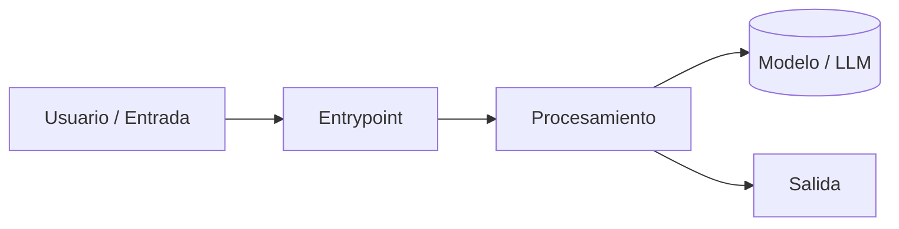

# Arquitectura

## Diagrama

## Componentes
| Componente | Responsabilidad | Tecnología | Decisión |
|---|---|---|---|
| Entrypoint | | | [[ADR-001]] |

## Flujo de datos
1.

Todas las decisiones: [[Decisiones]]
