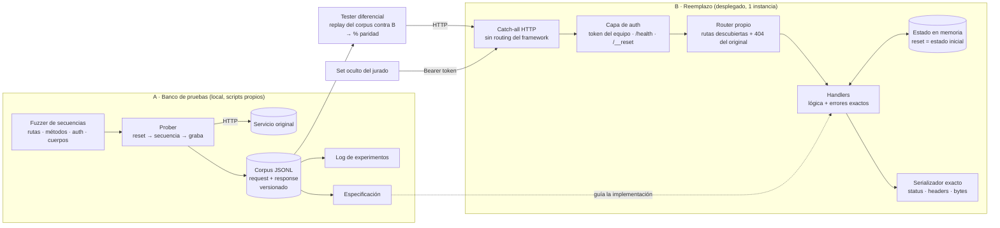

# Arquitectura

> [!info] Dos sistemas
> **A. Banco de pruebas (local):** descubre el comportamiento del original y genera evidencia.
> **B. Reemplazo (desplegado):** reproduce ese comportamiento sin hablar nunca con el original.
> Lo único que los conecta es el **corpus** de request/response grabados y la **spec**.

## Diagrama

## Componentes
| Componente | Responsabilidad | Tecnología | Decisión |
|---|---|---|---|
| Fuzzer | Genera secuencias de requests: wordlist de rutas, todos los métodos, variantes de auth, mutaciones de cuerpo, valores frontera | Python + `httpx` | [[ADR-003]] |
| Prober | `reset` → ejecuta la secuencia → graba cada par request/response al corpus | Python | [[ADR-003]] |
| Corpus | Fuente de verdad del comportamiento observado; versionado en git (detecta el incidente por diff) | JSONL | [[ADR-003]] |
| Catch-all HTTP | Recibe **cualquier** request sin que el framework responda por su cuenta | Por decidir | [[ADR-001]] |
| Capa de auth | Token del equipo → habilita `/health` y `/__reset`; cualquier otra variante → se comporta como el original | — | [[ADR-001]] |
| Estado | Store en memoria con snapshot inicial; `/__reset` lo restaura | dict en memoria | [[ADR-002]] |
| Serializador exacto | Escribe bytes, status y `Content-Type` tal como los envía el original | — | [[ADR-001]] |
| Tester diferencial | Reproduce el corpus contra el reemplazo y compara → métricas de [[Plan de evaluación]] | Python | [[ADR-003]] |
| Despliegue | URL pública estable desde las 20:00 hasta el final del demo day, sin cold starts | Por decidir | [[ADR-004]] |

## Flujo
1. **Descubrir:** fuzzer → prober → original → corpus.
2. **Entender:** leer el corpus → hipótesis → experimento dirigido → regla en la [[Especificación]] + entrada en el [[Log de experimentos]].
3. **Reproducir:** implementar la regla en el reemplazo.
4. **Verificar:** el tester diferencial reproduce el corpus contra el reemplazo → % de paridad. Lo que falla es el próximo experimento.
5. **Repetir** hasta las ~18:00; después congelar y endurecer.

## Cómo absorbe cambios (incidente)
- El corpus está versionado: si el original cambia, re-correr el prober y hacer `diff` contra el corpus anterior muestra exactamente qué cambió.
- El tester diferencial dice qué partes del reemplazo dejaron de coincidir.
- Las reglas están aisladas por handler: un cambio de comportamiento toca un módulo.
- Token, puerto y flags van en variables de entorno, no en el código.

Todas las decisiones: [[Decisiones]]
