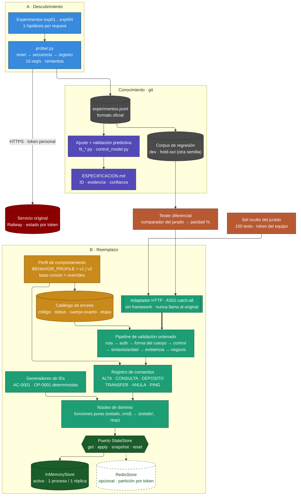

# Diagrama de arquitectura — Caja Negra

Renderizado: `diagrama-arquitectura.png` / `diagrama-arquitectura.svg` (fuente: `diagrama-arquitectura.mmd`, Mermaid + ELK).

**Lectura (de arriba abajo):**
- **A · Descubrimiento** — único componente que habla con el original (token personal, 10 req/s). Cada request queda en el log con su hipótesis.
- **Conocimiento** — único puente entre A y B: `experimentos.jsonl` → ajuste + validación predictiva → especificación; y el corpus de regresión (dev / hold-out con otra semilla).
- **Medición** — el tester diferencial reproduce el corpus contra el reemplazo con el comparador del jurado; el set oculto entra por el mismo adaptador.
- **B · Reemplazo (hexagonal)** — adaptador HTTP (borde) → pipeline ordenado de validación guiado por el **catálogo de errores** (datos) → **registro de comandos** (un módulo por comando) → **núcleo de dominio puro** → **puerto StateStore** (InMemory activo; Redis opcional). El **perfil de comportamiento** (`BEHAVIOR_PROFILE`) selecciona catálogo y comandos: así se absorbe el cambio de las 15:30 sin tocar el núcleo.
- Flecha gruesa = camino crítico de cada request. Discontinuo = adaptador posible, no desplegado.

